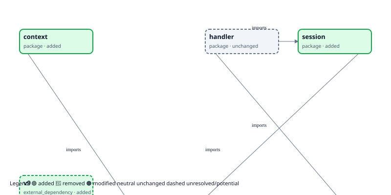

# Impactr

**See the impact before you merge.**

Impactr is a local-first Go CLI that compares Git revisions, builds an evidence-backed architecture graph, calculates a bounded blast radius, renders reviewable diagrams, and optionally explains the facts with a CPU-only embedded model. Deterministic analysis remains useful when no model is installed.



## Install

```bash
brew install andrew-ships-stuff/tap/impactr
# Until the first release:
go install github.com/andrew-ships-stuff/impactr/cmd/impactr@latest
```

Model weights are never installed by Homebrew. To enable local AI after reviewing its license:

```bash
impactr model install
```

The default is Qwen2.5-0.5B-Instruct Q4_0 (Apache-2.0, 409 MiB). Impactr displays the model license and verifies the published SHA-256 before atomically caching it. The explicit install command is the consent boundary; no extra prompt or flag is required. Local analysis never downloads a model implicitly.

## Use

```bash
impactr analyze                         # merge-base against the discovered default branch
impactr analyze --working-tree          # HEAD versus working tree
impactr analyze --staged --no-ai        # fast index analysis
impactr analyze --base origin/main --head HEAD
impactr analyze --format json
impactr render --format mermaid > impact.mmd
impactr hook install --type pre-push
impactr github comment --pr 123
```

For source builds, `make install` installs the CLI, `make test` runs the offline suite, and the one-liner `make run` analyzes `HEAD` against `master`. `make setup` installs both the CLI and model. Override defaults with `make run BASE=origin/main HEAD=my-branch IMPACTR_ARGS=--no-ai`.

Artifacts are written to `.impactr/`: `analysis.json`, before/after/diff graphs, architecture and impact SVG/PNG files, Mermaid, Markdown, and the versioned report. Exit `0` means analysis completed; `1` means configuration, Git, analysis, rendering, validation, or publishing failed. AI failure alone is not fatal: the report records a deterministic fallback.

## What is resolved

Go analysis provides module/package/type/function/method declarations, imports, and statically named direct calls with file/line evidence. JavaScript/TypeScript and Python initially provide syntax-level modules, imports, and declarations and emit an explicit limitation warning. Dynamic dispatch and unresolved external symbols are marked, never guessed.

The blast radius walks reverse dependencies with a configurable depth and node budget. Changed facts are confirmed; reachable callers are *potentially affected*. Impact scores and invented probabilities are intentionally absent.

## Automation

The repository is a reusable composite Action:

```yaml
name: Impactr
on: [pull_request]
permissions:
  contents: write # needed only to upload the attached impact.png
  pull-requests: write
jobs:
  impactr:
    runs-on: ubuntu-latest
    steps:
      - uses: actions/checkout@v4
        with: {fetch-depth: 0}
      - uses: andrew-ships-stuff/impactr@v1
```

Fork PRs receive a read-only token, so the Action analyzes and uploads artifacts but deliberately skips commenting. See [GitHub automation](docs/github-action.md) for the secure two-stage publisher and [GitLab CI](docs/gitlab-ci.md) for merge-request notes.

## Documentation

- [Architecture](docs/architecture.md)
- [Design research](docs/research.md)
- [CLI and configuration](docs/configuration.md)
- [Inference providers](docs/inference.md)
- [Git hooks](docs/hooks.md)
- [Security and trust boundaries](SECURITY.md)
- [Benchmarks](docs/performance.md)
- [Contributing](CONTRIBUTING.md)

Impactr is MIT licensed. The default model has its own Apache-2.0 license, shown before download.
